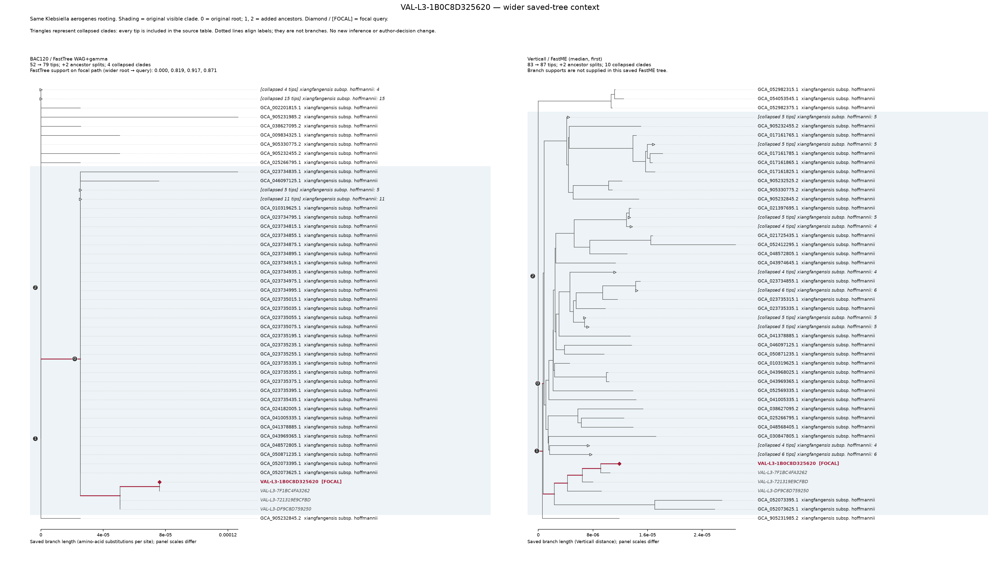

# Reviewing an uncertain call

Keep the automatic report and record any expert interpretation separately. A nearest reference is evidence; it does not become an assignment when the call is withheld. Terobacter uses whole isolate assemblies, with all supplied records retained. It runs no query CheckM2 and does not certify purity or explain every unaligned base.

Start with the reported reason. Inspect both aligned fractions, the closest type and diversity references, competing groups, and the sequence scopes. Percent values remain percentages: an AF of 0.8 is 0.8%, not 80%. A missing estimate is not zero ANI. An unresolved species/subspecies field stays null even if the nearest-reference name is present.

The default adds ANIm for eligible samples just below the species boundary. `--no-anim` skips those alignments and uses skani only. The [ANIm guide](assembly.md#boundary-anim) shows the reference FASTAs and evidence directory needed for alignments.

A successful rescue requires ANIm strictly above 96% in both directions, the AF and competitor safeguards, and a complete required panel. It assigns species only. Preserve method disagreement rather than selecting an estimator because it produces a preferred label. The [worked manual review](report-reference.md#a-worked-manual-review-example) shows an invented unresolved case with a competing species match.

## A recorded wider-context example

The public-assembly review case `VAL-L3-1B0C8D325620` matched the proposed *E. xiangfangensis* subsp. *hoffmannii* group. Its strongest diversity reference, GCA_009834325.1, had ANI 99.97%, query AF 93.65% and reference AF 92.61%. The type anchor GCA_001729745.1 had ANI 99.03%, query AF 84.29% and reference AF 91.66%. The strongest alternative named subspecies was 96.05% ANI, a 3.92 percentage-point gap. [All 140 saved comparisons](examples/VAL-L3-1B0C8D325620/saved-ani.tsv) retain the whole-assembly measurements.

The query recovered 117 of 120 unique BAC120 markers. Michael initially accepted hoffmannii with moderate confidence and requested two more ancestral splits of context. The wider displays retained the same trees and rooting: 75 named cohort tips plus four coded queries in BAC120, and 83 named cohort tips plus four coded queries in Verticall. All named cohort tips in those neighbourhoods were hoffmannii. After reviewing them, Michael retained the label and raised his confidence to high.



[Original closer views](examples/VAL-L3-1B0C8D325620/original-trees.png) · [Wider PDF](examples/VAL-L3-1B0C8D325620/wider-trees.pdf)

Red marks the focal query; shading marks the earlier displayed clade. Collapsed triangles represent labelled tip groups. The methods have different branch-length scales. BAC120 has weak internal branches, and the retained Verticall/FastME tree has no branch-support values. The additional context changed the expert confidence, not the ANI measurements or calling rules. This was a database-label review, not a withheld-call rescue or an additional independent accuracy test. Names follow the reviewed project framework and keep its proposed-combination status.

## Tree follow-up

Select an explicit comparison set before running a tree: the focal group's type and diverse members, types and diverse members of plausible competitors, and a nearby group outside the focal cluster. If genus membership is uncertain, add relevant neighbouring genera; the Enterobacter-focused panel cannot resolve every genus question. Record accessions, sequence hashes, scope, label source and selection rationale. Preserve the original whole-assembly comparison as primary; any justified alternative scope is a labelled sensitivity analysis.

For a quick distance-tree inspection, put exactly those chosen FASTAs in a new dedicated directory and retain their hashes:

```sh
sha256sum query.fa selected_refs/*.fa > selected-inputs.sha256
mashtree --numcpus 4 query.fa selected_refs/*.fa > follow-up.dnd
```

The wildcard is over your explicitly staged comparison set, not an existing archive. Mashtree is a separately installed optional investigation tool, not a Terobacter runtime requirement or an authoritative rank assignment. Check its version and settings before running. A core-genome or marker tree needs a documented alignment/model/scope choice and suitable neighbouring groups. Display support, missingness, alternatives and a full-tree overview alongside the local view.

Terobacter has no placement subcommand, public BAC120 placement database or browser feature. A Newick tree alone is not a placement package: the matching alignment, mask, model and reference identities are also required. Keep the report unresolved when follow-up evidence cannot distinguish the alternatives.

Record the original report hash, software, settings and data identities, reason for review, competing references, ANI and both AFs, tree inputs/settings/support, alternative interpretations, reviewer/date and rationale. A manual label stays separate from the automatic result and does not create a validly published name.
